# MiniGui

Current release: **0.1.0**. Requires MiniLang Compiler **1.2.6**.
See the [release notes](RELEASE_NOTES_0.1.0.md).

[](LICENSE)
[](.)

MiniGui is a GUI library for MiniLang that helps you build simple desktop
applications quickly. You describe the user interface declaratively in `.mson`,
keep the application logic in normal MiniLang code, and let MiniGui generate and
compile the glue code for a native Windows x64 or Linux x64 application.

In short:

- `.mson` describes windows, layouts, controls, attributes, and events.
- `.ml` contains your application logic and event handlers.
- `tools/minigui.ml` is the MiniGui command-line tool.
- `MiniGuiLib/minigui.ml` selects the Win32 or GTK runtime at compile time.

## API documentation

Browse the committed [MiniDoc API reference](docs/api/markdown/README.md) for
the runtime library and command-line generator, or open
`docs/api/html/index.html` locally. The [Linux API reference](docs/api/linux/markdown/README.md)
and `docs/api/linux/html/index.html` document the target-specific implementation. The MiniLang sources use `//!` file comments
and `///` declaration comments with structured parameter and return contracts.

```powershell
pwsh .\tools\generate_minidoc.ps1
pwsh .\tools\generate_minidoc.ps1 -Check
pwsh .\tools\generate_minidoc.ps1 -Target linux-x64
```

The strict [`minidoc.toml`](minidoc.toml) configuration keeps the checked-in
reference and source documentation aligned.

## Screenshot

The minimal hello example is built from `examples/hello-gui/app.mson` and
`examples/hello-gui/app.ml`.

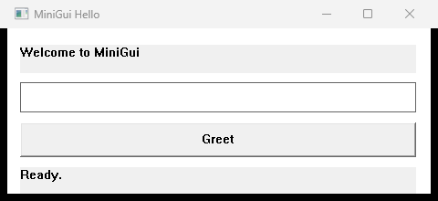

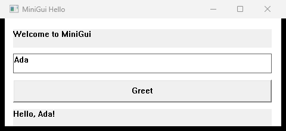

## Project Layout

MiniGui is its own project and is expected to live next to the MiniLang
compiler checkouts:

```text
workspace/
  MiniGui/
    MiniGuiLib/
    tools/
    examples/
    schemas/
    tests/
  MiniLangCompilerPy/
    mlc_win64.py
  MiniLangCompilerML/
    build/mlc_win64.exe
```

The Python compiler is currently the faster compiler for MiniGui builds.
MiniGui targets native Windows x64 (Win32) and Linux x64 (GTK 3). The same MSON
and code-behind can be compiled for either target. See [building for Windows and
Linux](docs/platforms.md) for native dependencies, cross-builds and deployment.

## Quick Start

MiniGui itself is written in MiniLang. Build the native Windows extension and CLI with the Python compiler:

```powershell
cd MiniGui
pwsh ./native/windows/build.ps1
py -3.14 ..\MiniLangCompilerPy\mlc_win64.py .\tools\minigui.ml .\tools\minigui.exe -I . -I ..\MiniLangCompilerPy
```

Validate, generate, and build the hello example:

```powershell
.\tools\minigui.exe validate .\examples\hello-gui\app.mson
.\tools\minigui.exe generate .\examples\hello-gui\app.mson --output .\examples\hello-gui\build\app.gui.ml
.\tools\minigui.exe build .\examples\hello-gui\app.mson --output .\examples\hello-gui\build\hello-gui.exe --compiler ..\MiniLangCompilerPy\mlc_win64.py
```

Run the finished application:

```powershell
.\examples\hello-gui\build\hello-gui.exe
```

## CLI

```powershell
.\tools\minigui.exe validate <app.mson>
.\tools\minigui.exe generate <app.mson> --output <generated.gui.ml>
.\tools\minigui.exe build <app.mson> --output <app.exe>
```

Useful options:

- `--target windows-x64|linux-x64` selects the application target (default: host).
- `--compiler <path>` selects the MiniLang compiler.
- `--output <file>` sets the generated source or executable output path.
- `--code-behind <file>` overrides the `codeBehind` value from `.mson`.
- `--generated-dir <dir>` chooses the directory for generated files.
- `--include-dir <dir>` adds MSON import search paths.
- `--no-compile` generates `.gui.ml` without compiling an executable.
- `--keep-generated` keeps generated files after `build`.

## A Minimal Application

`app.mson`:

```json
{
  "$schema": "../../schemas/minigui.schema.json",
  "version": 1,
  "namespace": "hello_gui",
  "codeBehind": "app.ml",
  "application": {
    "name": "HelloGui",
    "startupWindow": "mainWindow"
  },
  "windows": [
    {
      "id": "mainWindow",
      "type": "Window",
      "properties": {
        "title": "MiniGui Hello",
        "width": 480,
        "height": 220,
        "startPosition": "centerScreen"
      },
      "layout": {
        "type": "VerticalStack",
        "properties": { "padding": 14, "spacing": 8 },
        "children": [
          {
            "id": "headlineLabel",
            "type": "Label",
            "properties": { "text": "Welcome to MiniGui" }
          },
          {
            "id": "nameTextBox",
            "type": "TextBox",
            "properties": { "text": "" },
            "events": { "textChanged": "onNameChanged" }
          },
          {
            "id": "greetButton",
            "type": "Button",
            "properties": { "text": "Greet" },
            "events": { "click": "onGreetButtonClick" }
          },
          {
            "id": "resultLabel",
            "type": "Label",
            "properties": { "text": "" }
          }
        ]
      }
    }
  ]
}
```

`app.ml`:

```minilang
package hello_gui

import MiniGuiLib.minigui as MiniGui

function onNameChanged(ui, event)
  if event.newValue == "" then
    MiniGui.Control.setText(ui.resultLabel, "")
  end if
  return 0
end function

function onGreetButtonClick(ui, event)
  name = MiniGui.Control.getText(ui.nameTextBox)
  if name == "" then
    MiniGui.Control.setText(ui.resultLabel, "Please enter a name.")
  else
    MiniGui.Control.setText(ui.resultLabel, "Hello, " + name + "!")
  end if
  return 0
end function
```

For every control with an `id`, the generator creates a field on the generated
`ui` object. In the example above you can access `ui.nameTextBox`,
`ui.greetButton`, and `ui.resultLabel`.

## MSON Structure

An MSON file is JSON with the `.mson` extension.

```json
{
  "version": 1,
  "namespace": "my_app",
  "codeBehind": "app.ml",
  "resources": {},
  "imports": [],
  "application": {
    "name": "MyApp",
    "startupWindow": "mainWindow"
  },
  "windows": [],
  "components": []
}
```

Required fields:

- `version`: currently always `1`.
- `namespace`: the MiniLang package for the generated application.
- `application.name`: the application name.
- `application.startupWindow`: the `id` of the startup window.
- `windows`: the list of windows.

Optional fields:

- `codeBehind`: MiniLang file containing event handlers.
- `resources`: reusable values resolved at generation time.
- `imports`: additional `.mson` files.
- `components`: reusable UI building blocks.

## Layouts

Layouts group and position controls.

### VerticalStack

Arranges children from top to bottom.

```json
{
  "type": "VerticalStack",
  "properties": { "padding": 12, "spacing": 8 },
  "children": [
    { "id": "titleLabel", "type": "Label", "properties": { "text": "Title" } },
    { "id": "saveButton", "type": "Button", "properties": { "text": "Save" } }
  ]
}
```

### HorizontalStack

Arranges children from left to right.

```json
{
  "type": "HorizontalStack",
  "properties": { "spacing": 8 },
  "children": [
    { "id": "firstName", "type": "TextBox", "properties": { "width": "fill", "minWidth": 160 } },
    { "id": "lastName", "type": "TextBox", "properties": { "width": "fill", "minWidth": 160 } }
  ]
}
```

### Grid

Distributes children across columns. The `columns` property sets the column
count.

```json
{
  "type": "Grid",
  "properties": { "columns": 2, "spacing": 8 },
  "children": [
    { "id": "countryComboBox", "type": "ComboBox", "properties": { "items": ["DE", "US"] } },
    { "id": "cityListBox", "type": "ListBox", "properties": { "items": ["Berlin", "Bonn"] } }
  ]
}
```

### Canvas

Places controls at fixed `x` and `y` coordinates.

```json
{
  "type": "Canvas",
  "children": [
    { "id": "okButton", "type": "Button", "properties": { "text": "OK", "x": 20, "y": 20, "width": 100 } }
  ]
}
```

### DockPanel

Docks children to the edges of the remaining area. Use child `dock` values
`top`, `bottom`, `left`, `right`, or `fill`.

```json
{
  "type": "DockPanel",
  "properties": { "spacing": 6 },
  "children": [
    { "id": "toolbar", "type": "ToolBar", "properties": { "dock": "top", "height": 30, "items": ["Save"] } },
    { "id": "status", "type": "StatusBar", "properties": { "dock": "bottom", "height": 24, "text": "Ready" } },
    { "id": "content", "type": "Panel", "properties": { "dock": "fill" } }
  ]
}
```

### WrapPanel

Places children left-to-right and wraps to the next row when the current row is
full.

```json
{
  "type": "WrapPanel",
  "properties": { "spacing": 8 },
  "children": [
    { "id": "tagA", "type": "Button", "properties": { "text": "A", "width": 80 } },
    { "id": "tagB", "type": "Button", "properties": { "text": "B", "width": 80 } }
  ]
}
```

## Common Attributes

These properties can be used on controls:

- `text`: visible text.
- `width`, `height`: a number, `"auto"`, or `"fill"`.
- `x`, `y`: position inside a `Canvas`.
- `visible`: `true` or `false`.
- `enabled`: `true` or `false`.
- `margin`: reserved for layout spacing.
- `horizontalAlignment`: `"left"`, `"center"`, `"right"`, `"fill"`, or `"stretch"`.
- `verticalAlignment`: `"top"`, `"center"`, `"bottom"`, `"fill"`, or `"stretch"`.
- `alignment`: shorthand for horizontal alignment.
- `dock`: especially useful with `"fill"`.
- `fill`: `true` sets the width to the available space.
- `resizeMode`: runtime resize behavior. Supported values are `"scale"`,
  `"none"`, `"anchor"`, and `"fill"`.
- `anchor`: edge anchors for `resizeMode: "anchor"`, for example
  `"left,top"`, `"right,bottom"`, or `"left,top,right,bottom"`.
- `minWidth`, `minHeight`, `maxWidth`, `maxHeight`: size constraints.
- `tooltip`: tooltip text.
- `tabIndex`: keyboard navigation order.
- `row`, `column`, `rowSpan`, `columnSpan`: reserved for richer grid placement.
- `foreground`, `background`: native text/background styling for standard Win32 controls.
- `fontFamily`, `fontSize`: native font selection. `fontWeight` remains platform-dependent.
- `borderColor`, `borderWidth`: GTK CSS borders; Windows border rendering remains reserved.

Example:

```json
{
  "id": "nameTextBox",
  "type": "TextBox",
  "properties": {
    "text": "Ada",
    "width": "fill",
    "minWidth": 220,
    "enabled": true,
    "visible": true,
    "tooltip": "Enter a name",
    "tabIndex": 1
  }
}
```

### Resize Behavior

MiniGui keeps older generated applications compatible by using
`resizeMode: "scale"` when no explicit mode is set. That scales a control's
position and size proportionally to its parent. For form-like interfaces, set a
more explicit mode:

- `none`: keep the generated position and size.
- `anchor`: keep the control attached to selected parent edges. Anchoring left
  and right stretches the width; anchoring only right moves the control with the
  right edge.
- `fill`: grow width and height with the parent.

Size constraints are applied again during runtime resize, so `minWidth`,
`minHeight`, `maxWidth`, and `maxHeight` are not just generation hints.

```json
{
  "id": "contentTabs",
  "type": "TabControl",
  "properties": {
    "items": ["Input", "Data"],
    "width": "fill",
    "height": 420,
    "resizeMode": "anchor",
    "anchor": "left,top,right,bottom",
    "minWidth": 520,
    "minHeight": 240
  }
}
```

## Controls

MiniGui currently supports these controls:

All controls can also use `focus` and `blur` events. The table lists the
control-specific events in addition to those common focus events.

| Control | Purpose | Important properties | Events |
| --- | --- | --- | --- |
| `Label` | Display text | `text` | - |
| `Button` | Trigger an action | `text` | `click`, `clicked` |
| `FilePicker` | Button that opens a native open-file dialog | `text`, `title`, `filter` | `click`, `clicked` |
| `FolderPicker` | Button that opens a native folder dialog | `text`, `title` | `click`, `clicked` |
| `ColorPicker` | Button that opens a native color dialog | `text`, `title`, `value` | `click`, `clicked` |
| `TextBox` | Single-line input | `text`, `placeholder` | `textChanged`, `changed`, `change` |
| `SearchBox` | Single-line search input | `text`, `placeholder`, `maxLength` | `textChanged`, `changed`, `change` |
| `TextArea` | Multi-line input | `text`, `placeholder` | `textChanged`, `changed`, `change` |
| `PasswordBox` | Masked single-line input | `text`, `placeholder`, `maxLength`, `readOnly` | `textChanged`, `changed`, `change`, `submit`, `validating`, `validated` |
| `NumberBox` | Numeric input | `minimum`, `maximum`, `value`, `step`, `readOnly` | `textChanged`, `valueChanged`, `changed`, `change` |
| `SpinBox` | Numeric input with native up/down arrows | `minimum`, `maximum`, `value`, `step`, `readOnly` | `textChanged`, `valueChanged`, `changed`, `change` |
| `CheckBox` | Boolean choice | `text`, `checked` | `click`, `clicked` |
| `ToggleSwitch` | Boolean toggle control | `text`, `checked` | `click`, `clicked` |
| `RadioButton` | Choice inside a group | `text`, `checked` | `click`, `clicked` |
| `Image` | Bitmap image or image placeholder | `source`, `stretch`, `text` | `click`, `clicked` |
| `Separator` | Horizontal or vertical separator | `orientation` | - |
| `Splitter` | Draggable horizontal or vertical split marker | `orientation`, `targetBefore`, `targetAfter` | `valueChanged`, `changed`, `change` |
| `LinkLabel` | Clickable text link | `text`, `url`, `visited` | `click`, `clicked` |
| `Panel` | Borderless container | `padding`, `spacing`, `children` | - |
| `ScrollViewer` | Scrollable container host | `horizontalScroll`, `verticalScroll`, `padding`, `spacing`, `children` | - |
| `GroupBox` | Labeled container | `text`, `padding`, `spacing`, `children` | - |
| `ComboBox` | Drop-down selection | `items`, `selectedIndex` | `selectionChanged`, `selected`, `changed`, `change` |
| `EditableComboBox` | Editable drop-down selection | `items`, `selectedIndex`, `text` | `selectionChanged`, `selected`, `changed`, `change` |
| `ListBox` | List selection | `items`, `selectedIndex` | `selectionChanged`, `selected`, `changed`, `change` |
| `ScrollBar` | Scroll or value control | `orientation`, `minimum`, `maximum`, `value`, `smallStep`, `largeStep` | `scrollChanged`, `valueChanged`, `changed`, `change` |
| `Slider` | Trackbar value control | `orientation`, `minimum`, `maximum`, `value`, `smallStep`, `largeStep` | `scrollChanged`, `valueChanged`, `changed`, `change` |
| `ProgressBar` | Display progress | `minimum`, `maximum`, `value` | `scrollChanged`, `valueChanged`, `changed`, `change` |
| `TabControl` | Tabbed interface | `items`, `selectedIndex`, `children` | `selectionChanged`, `selected`, `changed`, `change` |
| `MenuBar` | Application menu bar | `items` | `click`, `clicked` |
| `ContextMenu` | Native right-click popup menu on its parent | `items` | `click`, `clicked` |
| `ToolBar` | Toolbar | `items` | `click`, `clicked` |
| `StatusBar` | Status line | `text` | - |
| `TreeView` | Tree navigation | `items` | `selectionChanged`, `selected`, `changed`, `change` |
| `ListView` | List/report view | `columns`, `columnWidths`, `items`, `selectedIndex` | `selectionChanged`, `selected`, `changed`, `change` |
| `Table` | Table-like list backed by `ListView` | `columns`, `columnWidths`, `items`, `selectedIndex` | `selectionChanged`, `selected`, `changed`, `change` |
| `DataGrid` | Explicit grid/table control backed by report-mode ListView | `columns`, `columnWidths`, `items`, `selectedIndex`, `editable` | `selectionChanged`, `selected`, `changed`, `change` |
| `DatePicker` | Date input | `text` | `textChanged`, `changed`, `change` |
| `DateTimePicker` | Date/time input | `text` | `textChanged`, `changed`, `change` |
| `TimePicker` | Time input | `text` | `textChanged`, `changed`, `change` |
| `Calendar` | Month calendar selector | `text` | `textChanged`, `changed`, `change` |

## Advanced controls

The [advanced-controls example](examples/advanced-controls/app.mson) uses all
seven additions on both platforms. Their shared API is described in
[advanced controls](docs/advanced-controls.md).

| Control | Purpose | Main properties |
| --- | --- | --- |
| RichTextBox | Multiline text with range formatting | text, readOnly, maxLength |
| CodeEditor | Syntax-colored code editing | text, language, readOnly |
| PropertyGrid | Editable property/value rows | items |
| TrayIcon | Desktop tray entry with an action menu | text, items, source |
| WebView | Embedded WebView2 / WebKitGTK browser | url or html |
| DrawingCanvas | Retained lines, rectangles and text | width, height |
| Chart | Bar and line charts | values, chartType, color |

## Control Screenshot Gallery

These screenshots are cropped from the MiniGui Control Gallery example.

| Control | Screenshot |
| --- | --- |
| `Label` | [](docs/images/controls/label.png) |
| `Button` | [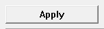](docs/images/controls/button.png) |
| `TextBox` | [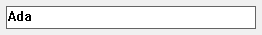](docs/images/controls/textbox.png) |
| `TextArea` | [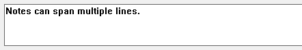](docs/images/controls/textarea.png) |
| `PasswordBox` | [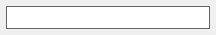](docs/images/controls/passwordbox.png) |
| `NumberBox` | [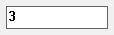](docs/images/controls/numberbox.png) |
| `CheckBox` | [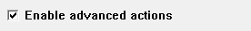](docs/images/controls/checkbox.png) |
| `RadioButton` | [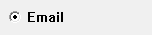](docs/images/controls/radiobutton.png) |
| `Image` | [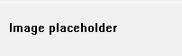](docs/images/controls/image.png) |
| `Separator` | [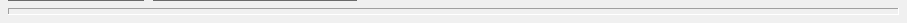](docs/images/controls/separator.png) |
| `LinkLabel` | [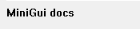](docs/images/controls/linklabel.png) |
| `Panel` | [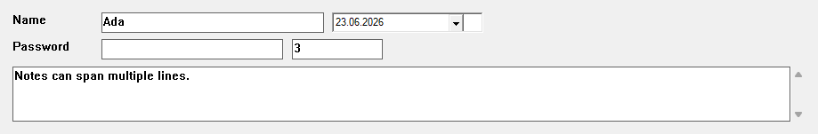](docs/images/controls/panel.png) |
| `ScrollViewer` | [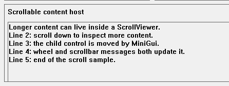](docs/images/controls/scrollviewer.png) |
| `GroupBox` | [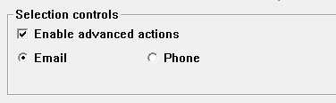](docs/images/controls/groupbox.png) |
| `ComboBox` | [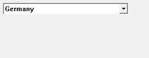](docs/images/controls/combobox.png) |
| `ListBox` | [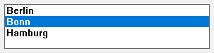](docs/images/controls/listbox.png) |
| `ScrollBar` | [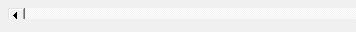](docs/images/controls/scrollbar.png) |
| `Slider` | [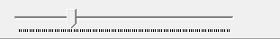](docs/images/controls/slider.png) |
| `ProgressBar` | [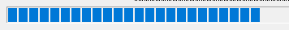](docs/images/controls/progressbar.png) |
| `TabControl` | [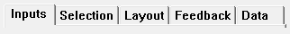](docs/images/controls/tabcontrol.png) |
| `MenuBar` | [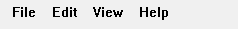](docs/images/controls/menubar.png) |
| `ToolBar` | [](docs/images/controls/toolbar.png) |
| `StatusBar` | [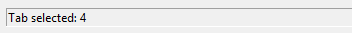](docs/images/controls/statusbar.png) |
| `TreeView` | [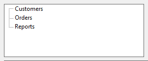](docs/images/controls/treeview.png) |
| `ListView` | [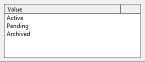](docs/images/controls/listview.png) |
| `Table` | [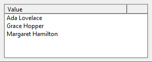](docs/images/controls/table.png) |
| `DatePicker` | [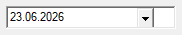](docs/images/controls/datepicker.png) |

## Control Examples

### Button

```json
{
  "id": "saveButton",
  "type": "Button",
  "properties": { "text": "Save", "width": 120, "height": 30 },
  "events": { "click": "onSaveClick" }
}
```

```minilang
function onSaveClick(ui, event)
  MiniGui.Control.setText(ui.statusBar, "Saved")
  return 0
end function
```

### TextBox and TextArea

```json
{
  "id": "notesTextArea",
  "type": "TextArea",
  "properties": {
    "text": "Notes",
    "height": 80,
    "width": "fill",
    "placeholder": "Enter notes"
  },
  "events": { "change": "onNotesChanged" }
}
```

```minilang
function onNotesChanged(ui, event)
  MiniGui.Control.setText(ui.statusBar, "Text changed: " + event.newValue)
  return 0
end function
```

### PasswordBox and NumberBox

```json
{
  "id": "passwordBox",
  "type": "PasswordBox",
  "properties": { "maxLength": 32, "width": "fill" },
  "events": { "change": "onPasswordChanged" }
}
```

```json
{
  "id": "quantityNumberBox",
  "type": "NumberBox",
  "properties": { "minimum": 1, "maximum": 99, "value": 3, "step": 1 },
  "events": { "valueChanged": "onQuantityChanged" }
}
```

```minilang
function onQuantityChanged(ui, event)
  quantity = MiniGui.Control.getValue(ui.quantityNumberBox)
  MiniGui.Control.setText(ui.statusBar, "Quantity: " + quantity)
  return 0
end function
```

### CheckBox and RadioButton

```json
{
  "id": "advancedCheckBox",
  "type": "CheckBox",
  "properties": { "text": "Advanced options", "checked": true },
  "events": { "click": "onAdvancedClicked" }
}
```

```minilang
function onAdvancedClicked(ui, event)
  enabled = MiniGui.Control.isChecked(ui.advancedCheckBox)
  MiniGui.Control.setEnabled(ui.detailsPanel, enabled)
  return 0
end function
```

### ComboBox and ListBox

```json
{
  "id": "countryComboBox",
  "type": "ComboBox",
  "properties": {
    "items": ["Germany", "United States", "France"],
    "selectedIndex": 0,
    "width": "fill"
  },
  "events": { "selected": "onCountrySelected" }
}
```

```minilang
function onCountrySelected(ui, event)
  selected = MiniGui.Control.getSelectedText(ui.countryComboBox)
  MiniGui.Control.setText(ui.resultLabel, "Country: " + selected)
  return 0
end function
```

### Slider, ScrollBar, and ProgressBar

```json
{
  "id": "volumeSlider",
  "type": "Slider",
  "properties": {
    "orientation": "horizontal",
    "minimum": 0,
    "maximum": 100,
    "value": 25,
    "smallStep": 5,
    "largeStep": 20,
    "width": "fill",
    "height": 32
  },
  "events": { "valueChanged": "onVolumeChanged" }
}
```

```minilang
function onVolumeChanged(ui, event)
  MiniGui.Control.setText(ui.volumeLabel, "Volume: " + event.newValue)
  MiniGui.Control.setValue(ui.progressBar, event.newValue)
  return 0
end function
```

### Panel and GroupBox

```json
{
  "id": "customerGroup",
  "type": "GroupBox",
  "properties": {
    "text": "Customer",
    "height": 120,
    "width": "fill",
    "padding": 10,
    "spacing": 8
  },
  "children": [
    { "id": "nameTextBox", "type": "TextBox", "properties": { "width": "fill" } },
    { "id": "emailTextBox", "type": "TextBox", "properties": { "width": "fill" } }
  ]
}
```

### TabControl

```json
{
  "id": "tabs",
  "type": "TabControl",
  "properties": {
    "items": ["Input", "Data"],
    "selectedIndex": 0,
    "height": 220,
    "width": "fill"
  },
  "events": { "selected": "onTabSelected" },
  "children": [
    { "id": "inputPanel", "type": "Panel", "properties": { "height": 80 } },
    { "id": "dataPanel", "type": "Panel", "properties": { "height": 80 } }
  ]
}
```

### ToolBar, MenuBar, ContextMenu, and StatusBar

```json
{
  "id": "openFilePicker",
  "type": "FilePicker",
  "properties": {
    "text": "Open file",
    "title": "Open file",
    "filter": "Text files (*.txt)|*.txt|All files (*.*)|*.*"
  },
  "events": { "click": "onOpenFile" }
}
```

```json
{
  "id": "mainToolBar",
  "type": "ToolBar",
  "properties": {
    "items": ["New", "Open", "Save", "Refresh"],
    "height": 30,
    "width": "fill"
  },
  "events": { "click": "onToolbarClick" }
}
```

```json
{
  "id": "mainMenu",
  "type": "MenuBar",
  "properties": {
    "items": ["File", "Edit", "View", "Help"],
    "height": 24,
    "width": "fill"
  },
  "events": { "clicked": "onMenuClick" }
}
```

```json
{
  "id": "rowContextMenu",
  "type": "ContextMenu",
  "properties": {
    "items": ["Open", "Rename", "Delete"]
  },
  "events": { "clicked": "onContextMenuClick" }
}
```

```json
{
  "id": "statusBar",
  "type": "StatusBar",
  "properties": { "text": "Ready", "height": 24, "width": "fill" }
}
```

### TreeView, ListView, DataGrid, and Date Controls

```json
{
  "type": "Grid",
  "properties": { "columns": 2, "spacing": 8 },
  "children": [
    {
      "id": "navigationTree",
      "type": "TreeView",
      "properties": {
        "items": [
          { "text": "Customers", "children": ["Active", "Archived"] },
          { "text": "Orders", "children": ["Open", "Shipped"] },
          { "text": "Reports", "children": ["Revenue", "Inventory"] }
        ],
        "height": 120
      },
      "events": { "selected": "onTreeSelected" }
    },
    {
      "id": "customerTable",
      "type": "DataGrid",
      "properties": {
        "columns": ["Name", "Role", "Status"],
        "columnWidths": [160, 120, 90],
        "items": [
          ["Ada Lovelace", "Analyst", "Active"],
          ["Grace Hopper", "Compiler", "Active"],
          ["Margaret Hamilton", "Apollo", "Active"]
        ],
        "selectedIndex": 0,
        "editable": true,
        "height": 120
      },
      "events": { "selected": "onTableSelected" }
    }
  ]
}
```

```json
{
  "id": "birthDatePicker",
  "type": "DatePicker",
  "properties": { "width": 150 },
  "events": { "changed": "onDateChanged" }
}
```

```json
{
  "id": "appointmentTimePicker",
  "type": "TimePicker",
  "properties": { "width": 120 },
  "events": { "changed": "onDateChanged" }
}
```

## Events and Code-Behind

Event handlers live in the code-behind file and must accept exactly two
parameters:

```minilang
function onSomething(ui, event)
  return 0
end function
```

`ui` is the generated handle to windows and controls. `event` contains:

- `sender`: the control that raised the event.
- `eventType`: the event name.
- `oldValue`: previous value, when available.
- `newValue`: new value, when available.
- `cancel`: can be set to `true` in a `close` handler.

Window events:

- `load`
- `close`
- `resized`

Common control events:

- `focus`: the control received keyboard focus.
- `blur`: the control lost keyboard focus.

Selection and value aliases preserve their event name in `event.eventType`.
For example, a MSON `valueChanged` handler receives `event.eventType ==
"valueChanged"`, not the lower-level Win32 event family used internally.

Close-event example:

```json
{
  "id": "mainWindow",
  "type": "Window",
  "events": { "close": "onMainWindowClose" },
  "layout": { "type": "VerticalStack", "children": [] }
}
```

```minilang
function onMainWindowClose(ui, event)
  if MiniGui.Control.getText(ui.nameTextBox) == "" then
    event.cancel = true
    MiniGui.Control.setText(ui.statusBar, "Please enter a name first.")
  end if
  return 0
end function
```

## Runtime API

The most useful functions from `MiniGui.Control`:

```minilang
MiniGui.Control.setText(control, "Text")
text = MiniGui.Control.getText(control)

MiniGui.Control.setEnabled(control, true)
MiniGui.Control.setVisible(control, false)
MiniGui.Control.setReadOnly(control, true)
MiniGui.Control.setMaxLength(control, 32)

MiniGui.Control.setBounds(control, 20, 20, 200, 30)
MiniGui.Control.setPosition(control, 20, 20)
MiniGui.Control.setSize(control, 200, 30)
MiniGui.Control.setLayout(control, "anchor", "left,top,right", 160, -1, -1, -1)

checked = MiniGui.Control.isChecked(control)
MiniGui.Control.setChecked(control, true)

MiniGui.Control.addItem(control, "Item")
MiniGui.Control.setItems(control, ["A", "B", "C"])
MiniGui.Control.clearItems(control)
index = MiniGui.Control.getSelectedIndex(control)
MiniGui.Control.setSelectedIndex(control, 1)
text = MiniGui.Control.getSelectedText(control)

MiniGui.Control.setScrollRange(control, 0, 100)
MiniGui.Control.setScrollSteps(control, 5, 20)
MiniGui.Control.setScrollValue(control, 50)
value = MiniGui.Control.getScrollValue(control)

MiniGui.Control.setValueRange(control, 0, 100)
MiniGui.Control.setValue(control, 35)
value = MiniGui.Control.getValue(control)

MiniGui.Control.setColumnWidths(dataGrid, [160, 120, 90])
MiniGui.Control.setEditable(dataGrid, true)
MiniGui.Control.setCellText(dataGrid, 0, 1, "Updated")
cell = MiniGui.Control.getCellText(dataGrid, 0, 1)
```

`setLayout(control, resizeMode, anchor, minWidth, minHeight, maxWidth,
maxHeight)` uses `-1` for unset size constraints.

`setValue` and `getValue` are useful for `Slider`, `ScrollBar`, and
`ProgressBar`, `NumberBox`, and `SpinBox`. For `ComboBox` and `ListBox`, use
the selection functions.

When a `DataGrid` is editable, the user can double-click a cell to open an
inline editor. Press Enter or move focus away to commit the value; press Escape
to cancel the edit.

The most useful functions from `MiniGui.Events`:

```minilang
MiniGui.Events.bindClick(app, button, onClick, ui)
MiniGui.Events.bindClicked(app, button, onClick, ui)
MiniGui.Events.bindTextChanged(app, textBox, onText, ui)
MiniGui.Events.bindChange(app, control, onChange, ui)
MiniGui.Events.bindChanged(app, control, onChanged, ui)
MiniGui.Events.bindSelectionChanged(app, list, onSelection, ui)
MiniGui.Events.bindSelected(app, list, onSelected, ui)
MiniGui.Events.bindScrollChanged(app, slider, onScroll, ui)
MiniGui.Events.bindValueChanged(app, slider, onValue, ui)
MiniGui.Events.bindFocus(app, control, onFocus, ui)
MiniGui.Events.bindBlur(app, control, onBlur, ui)
```

## Dialog API

MiniGui includes native message boxes. The original `show*` helpers return the
native Windows result code:

```minilang
MiniGui.Dialog.showInfo(ui.app, "Saved", "The record was saved.")
MiniGui.Dialog.showWarning(ui.app, "Check input", "Some fields are incomplete.")
MiniGui.Dialog.showError(ui.app, "Error", "The operation failed.")

if MiniGui.Dialog.confirm(ui.app, "Close", "Close without saving?") then
  MiniGui.Window.close(ui.mainWindow)
end if
```

For new code, prefer the high-level helpers. They return stable strings:
`ok`, `cancel`, `yes`, `no`, `retry`, `abort`, `ignore`, or `unknown`.

```minilang
result = MiniGui.Dialog.showMessage(ui.app, "Delete", "Delete this item?", "yesNoCancel", "question")
if result == "yes" then
  MiniGui.Control.setText(ui.statusBar, "Deleted")
end if

answer = MiniGui.Dialog.yesNo(ui.app, "Close", "Close without saving?")
retry = MiniGui.Dialog.retryCancel(ui.app, "Network", "Try again?")

MiniGui.Dialog.info(ui.app, "Saved", "The record was saved.")
MiniGui.Dialog.warning(ui.app, "Check input", "Some fields are incomplete.")
MiniGui.Dialog.errorMessage(ui.app, "Error", "The operation failed.")
```

Native picker helpers are also available:

```minilang
path = MiniGui.Dialog.pickOpenFile(ui.app, "Open file", "Text files (*.txt)|*.txt|All files (*.*)|*.*")
target = MiniGui.Dialog.pickSaveFile(ui.app, "Save file", "Text files (*.txt)|*.txt|All files (*.*)|*.*")
folder = MiniGui.Dialog.pickFolder(ui.app, "Choose folder")
color = MiniGui.Dialog.pickColor(ui.app, "Choose color", "#336699")
```

The picker helpers return an empty string when the user cancels. `pickColor`
returns the fallback color when cancelled.

MiniGui also provides a native MiniGui-based input dialog helper:

```minilang
name = MiniGui.Dialog.showInput(ui.app, "Customer", "Customer name", "")
if name != "" then
  MiniGui.Control.setText(ui.resultLabel, "Customer: " + name)
end if
```

For custom modal dialogs, create a dialog window and add normal MiniGui controls
to `dialog.window`:

```minilang
dialog = MiniGui.Dialog.createCustom(ui.app, "detailsDialog", "Details", 420, 220)
label = MiniGui.Label.create(ui.app, dialog.window, "detailsLabel", "Custom content", 14, 14, 360, 24)
MiniGui.Dialog.showModal(dialog)
```

Interactive native dialogs and modal input dialogs are intentionally not opened
by the automated test suite, because they would block unattended test runs.

## Release Package

Build a distributable ZIP with the MiniGui CLI, runtime library, schema,
documentation, and examples:

```powershell
powershell -NoProfile -ExecutionPolicy Bypass -File .\tools\package-release.ps1 -Version 0.1.0 -Compiler ..\MiniLangCompilerPy\mlc_win64.py
```

The script writes `dist/MiniGui-<version>.zip` and a matching `.sha256` file.

## Resources

Resources are simple values that are resolved while generating MiniLang code.

```json
{
  "resources": {
    "windowTitle": "MiniGui Control Gallery",
    "heading": "MiniGui controls and attributes"
  },
  "windows": [
    {
      "id": "mainWindow",
      "type": "Window",
      "properties": {
        "title": { "$resource": "windowTitle" }
      },
      "layout": {
        "type": "VerticalStack",
        "children": [
          {
            "id": "titleLabel",
            "type": "Label",
            "properties": { "text": { "$resource": "heading" } }
          }
        ]
      }
    }
  ]
}
```

## Imports and Components

`imports` loads additional `.mson` files relative to the importing file or from
the `--include-dir` search paths.

```json
{
  "imports": ["resources/common.mson", "components/address-form.mson"]
}
```

Components are reusable UI building blocks:

```json
{
  "components": [
    {
      "name": "AddressForm",
      "content": {
        "type": "VerticalStack",
        "properties": { "spacing": 8 },
        "children": [
          { "id": "streetTextBox", "type": "TextBox", "properties": { "width": "fill" } },
          { "id": "cityTextBox", "type": "TextBox", "properties": { "width": "fill" } }
        ]
      }
    }
  ]
}
```

Use the component by its name:

```json
{
  "id": "shippingAddress",
  "type": "AddressForm"
}
```

When a component is used multiple times, MiniGui prefixes internal IDs with the
instance ID.

## Examples

- `examples/hello-gui`: a small application with `TextBox`, `Button`, `Label`,
  and event handlers.
- `examples/control-gallery`: a test and demo application covering all
  controls, attributes, layouts, and event binding paths.
- `examples/customer-form`: an example for imports, resources, and components.
- `examples/advanced-controls`: rich text, code editing, properties, tray, browser, canvas and charts.

Build the control gallery:

```powershell
.\examples\control-gallery\build.ps1
```

## Tests

The MiniGui test suite builds the CLI, validates the example applications,
checks generated code, starts GUI smoke tests, and verifies interactions such as
button clicks, slider changes, and resize behavior. Regression coverage also
includes Unicode/UTF-16 conversion, GDI and tooltip resource replacement,
shell-free compiler argument handling, malformed JSON/MSON, import cycles and
diamond imports, reserved identifiers, invalid handlers, and deterministic code
generation. When both compiler projects are available beside MiniGui, the suite
also builds the CLI with the Python and self-hosted compilers, verifies that the
two CLI executables and their generated MiniLang sources are byte-identical, and
runs a self-hosted build and runtime smoke test.

```powershell
.\tests\minigui\run_minigui_tests.ps1
```

## Compiler Requirements

MiniGui requires the current MiniLang Compiler 1.2.5 checkout (including the
native C-string return fix for Linux) and is tested with both the
Python and self-hosted compilers. It uses current language/runtime features such
as `const`, explicit `function inline` helpers, exact typed FFI declarations,
`copyArray`-backed growable lists, and the standard-library `StringBuilder`.

The runtime additionally uses these native interop helpers:

- `nativeCallback(fn, "wndproc")`
- `nativeBytesPtr(bytes)`
- `nativeRawValue(value)`
- `nativeValueFromRaw(int)`

`MiniGuiLib` uses these helpers for Win32 windows, window procedures, native
handles, and callback bridges.

The generator uses `std.ds.list`, `std.string_builder`, and `std.process` to
avoid repeated immutable array/string copies. Python-compiler builds resolve a
Python 3.14 interpreter directly; compiler arguments are passed to
`CreateProcessW` with Windows CRT quoting and never through `cmd.exe`.

## Performance and resource lifetime

Append-heavy MSON parsing and source generation use geometrically growing
buffers and materialize ordinary arrays only at API boundaries. This keeps
large declarative interfaces linear instead of repeatedly copying every
previous node or output line. Small scalar helpers that remain hot during
layout and native buffer access are explicitly inlineable.

The message loop handles normal resizing through `WM_SIZE`; its fallback timer
continues to cover native-window edge cases, while redundant polling after
every dispatched message is avoided. MiniGui owns style brushes and tooltip
windows: replacing a color or tooltip releases the previous native resource,
and leaving the application loop releases all remaining MiniGui-owned handles.

On Windows x64, a synthetic 3,000-label document (about 202 KiB of MSON) showed
the following results over five paired runs against the pre-optimization audit
baseline. Generated source was byte-identical in both cases.

| Measurement | Audit baseline | Current | Change |
| --- | ---: | ---: | ---: |
| Median generation time | 1,844.81 ms | 222.80 ms | -87.9% |
| Peak working set | 157.48 MiB | 43.70 MiB | -72.3% |

Small documents remain dominated by process startup; the hello/control-gallery
generation path showed no material regression.

## Security and input limits

The MSON reader rejects duplicate object keys, malformed JSON numbers, invalid
Unicode surrogate pairs, reserved MiniLang identifiers, and invalid event
handler names before source is emitted. Each MSON document is limited to 16 MiB,
container nesting to 128 levels, and one import graph to 4,096 distinct files.
Imports are cycle-checked, case-insensitively deduplicated on Windows, and shared
diamond dependencies are loaded once.

`minigui build` compiles and links the selected code-behind file. Therefore,
treat code-behind sources and explicitly supplied compiler executables as code,
not as untrusted data. MSON import paths may intentionally refer to any readable
local path; applications that accept third-party MSON should constrain their
own allowed roots before invoking MiniGui.

Native controls have UI-thread affinity. Worker threads may prepare data, but
must not mutate MiniGui controls directly; marshal such changes back to the UI
thread in application code.

## Extending MiniGui

To add a new control:

1. Extend control metadata and validation in `tools/minigui.ml`.
2. Implement the runtime constructor in `MiniGuiLib/minigui.ml`.
3. Update `schemas/minigui.schema.json`.
4. Extend the control gallery and tests.

The public MSON shape should stay stable: applications describe the UI
declaratively while the runtime hides native implementation details.

## Cross-platform verification

Run the existing Windows regression suite and the additional native-control suite:

```powershell
pwsh ./tests/minigui/run_minigui_tests.ps1
pwsh ./tests/minigui/run_cross_platform_tests.ps1 -LinuxDistro Ubuntu
```

On Linux, run `bash tests/minigui/run_linux_tests.sh`. It builds the native bridge,
tests GTK signals/models and the shared MiniLang API, then builds and starts all
four examples under Xvfb. See [platforms](docs/platforms.md) for dependencies.
